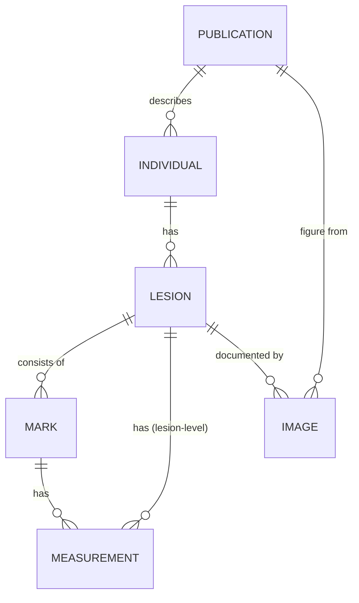

# Lesion record data schema (draft v0.1)

Status: draft for team review validation (Jira: "Design lesion record data schema", "Validate schema and vocabularies").

## 1. Purpose and scope

The database links published images, lesion features, measurements and interpretations, one record per lesion. The same schema stores:

- **published cases**: lesions taken from the literature, used for keyword search and comparison images;
- **user cases**: lesions described by a user through the guided form.

Both share one structure so that a user's answers can be matched directly against published cases. The guided form is generated from this schema: every controlled vocabulary below becomes a choice in the form, and every free-text field becomes a notes box.

Out of scope for this version: ML/LLM suggestions, user accounts, report templates. They will reference `Lesion` by id and do not change the tables below.

## 2. Conventions

**Missing values.** Literature often omits information. Three states must be kept apart, because search and evaluation treat them differently:

| State | Meaning | Stored as |
|---|---|---|
| reported | the source gives a value | the value |
| `NR` | not reported by the source | `"NR"` (vocabulary fields) or `status = "NR"` (measurements) |
| `NA` | does not apply (e.g. callus size when there is no healing) | `"NA"` / `status = "NA"` |
| empty | not yet entered by the curator | `null` |

**Units.** Lengths in millimetres, angles in degrees. Values are stored as numbers; the unit lives in the measurement row.

**Vocabularies.** Fields marked *(vocab)* take values from section 5. Fields marked *(multi)* take a list. Vocabularies are stored as data (lookup tables), not hard-coded, so experts can extend them without a code change.

**Verbatim text.** Most sections keep a `*_text` field with the source's own wording. Structured fields support search; the verbatim text preserves meaning when the vocabulary is too coarse.

## 3. Entity overview

- **Publication**: the source paper. User cases have no publication.
- **Individual**: one skeleton, as identified in the source (e.g. "116 Da").
- **Lesion**: one trauma (or suspected trauma) at one anatomical location. This is the unit of search, comparison and classification.
- **Mark**: an individual cut, puncture or fracture line inside a lesion. Needed because one lesion can have several marks with their own morphology and measurements (116 Da has two cut marks).
- **Measurement**: one quantity, for a mark or for the lesion as a whole.
- **Image**: one image file, with its licence and annotation status.

## 4. Fields

### 4.1 Publication

| Field | Type | Notes |
|---|---|---|
| id | id | |
| citation | text | Full reference, as shown in the app |
| authors | text | |
| year | integer | |
| title | text | |
| journal | text | |
| doi | text | Unique when present |

### 4.2 Individual (brief category: *Source and individual*)

| Field | Type | Notes |
|---|---|---|
| id | id | |
| publication_id | ref, nullable | Null for user cases |
| label | text | Identifier used in the source, e.g. `116 Da` |
| sex | vocab `sex` | |
| age_category | vocab `age_category` | |
| age_text | text | Verbatim, e.g. `>50 years` |
| site | text | e.g. `Spina necropolis, Ferrara` |
| country | text | |
| chronology_text | text | Verbatim, e.g. `5th–3rd c. BC` |
| chronology_start_year / chronology_end_year | integer, nullable | Negative for BC. Enables date-range filters |
| other_trauma | text | Other skeletal trauma reported for this individual, or `NR` |

### 4.3 Lesion

| Field | Type | Brief category | Notes |
|---|---|---|---|
| id | id | | |
| individual_id | ref | | |
| record_source | `published` \| `user_case` | | |
| case_ref | text | Source | Figure or case reference, e.g. `Fig. 5A` |
| **Anatomical location** | | | |
| bone | vocab `bone` | Location | |
| side | vocab `side` | Location | |
| portion | vocab `portion` | Location | Long bones; `NA` for others |
| aspects | multi vocab `aspect` | Location | Posteromedial = `[posterior, medial]` |
| joint_involvement | `yes` \| `no` \| `NR` | Location | |
| location_text | text | Location | Relative position, verbatim |
| **Documentation** | | | |
| examination_methods | multi vocab `examination_method` | Documentation | |
| preservation_text | text | Documentation | e.g. `diaphyseal segment lacking the articular ends` |
| **Morphology** | | | |
| lesion_pattern | vocab `lesion_pattern` | Morphology | |
| mark_count | integer \| `NR` | Morphology | |
| fragmentation | `yes` \| `no` \| `NR` | Morphology | |
| deformation | `yes` \| `no` \| `NR` | Morphology | Plastic deformation |
| morphology_text | text | Morphology | |
| **Timing and healing** | | | |
| timing | vocab `timing` | Timing | As reported / assessed |
| healing_present | `yes` \| `no` \| `NR` | Timing | |
| healing_stage | vocab `healing_stage` | Timing | `NA` when no healing |
| timing_features | multi vocab `timing_feature` | Timing | Evidence used to decide timing |
| complications_text | text | Timing | e.g. infection, non-union |
| **Classification and interpretation** | | | |
| trauma_category | vocab `trauma_category` | Interpretation | |
| trauma_subtype | vocab `trauma_subtype` | Interpretation | Valid subtypes depend on category |
| differential | multi vocab `differential` | Interpretation | Pseudopathology / variation / disease considered |
| instrument_text | text | Interpretation | e.g. `sword or dagger` |
| dynamics_text | text | Interpretation | e.g. `right-handed opponent, blow from behind` |
| vascular_involvement_text | text | Interpretation | |
| cause_of_death | `yes` \| `possible` \| `no` \| `uncertain` \| `NR` | Interpretation | |
| sequence_text | text | Interpretation | Relationship and order between marks/lesions |
| interpretation_by | `source_authors` \| `expert` \| `user` | Interpretation | Who made the interpretation. Never the ML/LLM |
| interpretation_text | text | Interpretation | Verbatim conclusion |

### 4.4 Mark (brief category: *Lesion morphology*, per mark)

| Field | Type | Notes |
|---|---|---|
| id | id | |
| lesion_id | ref | |
| label | text | e.g. `main mark`, `second mark` |
| orientation_text | text | e.g. `oblique, proximal/superior to distal/inferior` |
| cross_section | vocab `cross_section` | Cut marks |
| floor_text | text | e.g. `deep bottom` |
| margins | multi vocab `margin` | |
| flaking | `yes` \| `no` \| `NR` | Cortical splintering / flake detachment |
| description_text | text | e.g. `sharp upper edge, roughened lower edge` |

### 4.5 Measurement (brief category: *Measurements*)

One row per quantity. A reported-as-missing quantity is still a row with `status = "NR"`, so we can count how often sources omit it.

Why a separate table rather than columns on Lesion or Mark:

- **Fewer columns:** about 12 quantities, each with a value, status and note, would mean about 36 mostly empty columns.
- **Both levels:** one table holds quantities for a single mark and for the whole lesion.
- **Easy to extend:** a new quantity is one new vocabulary entry, with no change to the database or the form.
- **Counts gaps:** "not reported" rows show how often papers leave a quantity out.

If the experts name only a fixed 3–4 quantities that matter (open question 4), plain columns with a status each would be simpler, and this decision should be revisited.

| Field | Type | Notes |
|---|---|---|
| id | id | |
| lesion_id | ref | |
| mark_id | ref, nullable | Null for lesion-level quantities |
| quantity | vocab `quantity` | |
| value | number, nullable | Null unless status is `reported` |
| unit | `mm` \| `deg` \| `mm2` | |
| status | `reported` \| `NR` \| `NA` | |
| note | text | e.g. `maximum` |

### 4.6 Image (brief category: *Documentation*)

| Field | Type | Notes |
|---|---|---|
| id | id | |
| lesion_id | ref | |
| publication_id | ref, nullable | |
| figure_ref | text | e.g. `Fig. 5A` |
| file_path | text | Path in image storage |
| view | vocab `image_view` | |
| has_scale | `yes` \| `no` | |
| has_annotations | `yes` \| `no` | Arrows, circles, labels drawn on the image |
| clean_version_id | ref to Image, nullable | Version with annotations masked. Only clean versions are used for similar-image search and ML training, so a model cannot learn the arrows as a shortcut |
| licence | vocab `licence` | |
| licence_note | text | Permission details, attribution text |
| usable | `display_and_ml` \| `display_only` \| `ml_only` \| `none` | Derived from licence; enforced by the app |

## 5. Controlled vocabularies (first proposal)

All vocabularies also accept `NR`; most accept `NA`.

- **sex**: male, probable male, female, probable female, indeterminate
- **age_category**: fetus, infant, child, adolescent, young adult, middle adult, old adult, adult (unspecified)
  (proposed ranges in years: infant 0–2, child 3–12, adolescent 13–19, young adult 20–34, middle adult 35–49, old adult 50+)
- **bone**: frontal, parietal, occipital, temporal, sphenoid, zygomatic, maxilla, nasal, mandible, hyoid, cervical vertebra, thoracic vertebra, lumbar vertebra, sacrum, coccyx, rib, sternum, clavicle, scapula, humerus, radius, ulna, carpal, metacarpal, hand phalanx, os coxae, femur, patella, tibia, fibula, tarsal, metatarsal, foot phalanx
- **side**: left, right, midline, bilateral
- **portion**: proximal epiphysis, proximal metaphysis, diaphysis proximal third, diaphysis middle third, diaphysis distal third, diaphysis (unspecified), distal metaphysis, distal epiphysis
- **aspect**: anterior, posterior, medial, lateral, superior, inferior, proximal, distal, ectocranial, endocranial, internal, external
- **examination_method**: macroscopic, magnification (lens), stereomicroscope, SEM, radiograph, CT, micro-CT, histology
- **lesion_pattern**: cut mark, chop mark, puncture, depressed fracture, linear fracture, comminuted fracture, radiating fracture, concentric fracture, penetrating defect, projectile wound, perforation, other
- **timing**: antemortem, perimortem, postmortem, uncertain
- **healing_stage** (after Scianò et al. 2020): none, 1 hematoma, 2 cellular proliferation / periostitis, 3 soft callus, 4 hard callus, 5 remodelling
- **timing_feature**:
  - perimortem: irregular edges, hinging fragments, cortical flakes along margins, smoothed margins, radiating fractures, concentric fractures, staining preserved along margins, plastic deformation
  - postmortem: lighter-coloured margins, regular fragments, gnawing / carnivore punctures, other taphonomic evidence
  - antemortem: periosteal reaction, callus, rounded/remodelled margins, bridging
- **trauma_category**: blunt force, sharp force, sharp-blunt, projectile, not trauma, uncertain
- **trauma_subtype**:
  - sharp force: cut (incised), stab/puncture, saw
  - sharp-blunt: chop
  - blunt force: depressed fracture, linear fracture, comminuted fracture, other
  - projectile: gunshot, arrowhead, other
- **differential**: taphonomic (carnivore gnawing), taphonomic (rodent gnawing), taphonomic (root etching), taphonomic (excavation damage), taphonomic (dry-bone breakage), taphonomic (weathering), anatomical variation, bone disease
- **cross_section**: V-shaped, U-shaped, flat-bottomed, W-shaped, irregular
- **margin**: sharp, irregular, roughened, smoothed, bevelled, polished
- **quantity**: length, width, depth, diameter, area, fracture line extent, callus length, callus width, displacement, angulation, rotation, distance from landmark
- **image_view**: overview, detail, cross-section, radiograph, CT slice, micrograph
- **licence**: CC BY, CC BY-NC, CC BY-NC-ND, publisher permission, all rights reserved, unknown

## 6. Example: individual 116 Da

Full record: [`data/seed/case_116Da.json`](../data/seed/case_116Da.json). Mapping from the brief:

| Brief category | Stored as |
|---|---|
| Source and individual | Publication (Manzon et al. 2024) + Individual `116 Da`: male, old adult, `>50 years`, Spina necropolis, -500 to -201, no other trauma |
| Anatomical location | femur, right, diaphysis (unspecified), aspects `[posterior, medial]`, joint involvement NR |
| Documentation | macroscopic + magnification; radiograph/CT not reported; preservation text |
| Lesion morphology | Lesion: cut mark, `mark_count = 2`. Mark 1: oblique, V-shaped, flaking, sharp + roughened margins. Mark 2: proximal–distal |
| Measurements | Mark 1 depth 1.4 mm (reported, maximum); length, width NR. Mark 2 depth, length, width NR |
| Timing and healing | perimortem, healing `no`, stage `NA` |
| Classification | sharp force / cut; sword or dagger; dynamics, vascular involvement, sequence as text; cause of death `uncertain`; by source authors |

Nothing in the brief's example is lost. Two items needed free text (dynamics, mark sequence); that is acceptable because they are interpretations, not search keys.

## 7. How the app uses the schema

- **Guided form**: one step per brief category, in the order of section 4.3. Choices come from vocabularies; `uncertain` / `NR` is always offered.
- **Keyword search and filters**: filter on bone, side, portion, timing, trauma category/subtype, lesion pattern, timing features; full-text search on `*_text` fields and citation.
- **Similar cases**: compare a user case with published cases by overlap of structured fields (score per matching field), shown with their clean images.
- **Evaluation (Sprint 3)**: train/test split by `individual_id` and `publication_id`, label = `trauma_category` + `timing` where `interpretation_by` is `source_authors` or `expert`.
